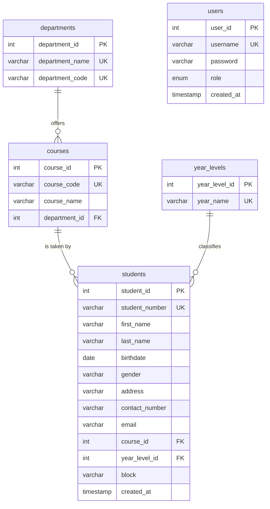

# Database Documentation

**Project:** Bicol University–Polangui Student Management System
**Database:** `student_management_system`
**Document type:** Technical database reference for a BSIT individual final project

---

## Table of Contents

1. [Purpose and Scope](#1-purpose-and-scope)
2. [Database at a Glance](#2-database-at-a-glance)
3. [How to Read the Table Reference](#3-how-to-read-the-table-reference)
4. [Entity–Relationship Overview](#4-entityrelationship-overview)
5. [Table Reference](#5-table-reference)
6. [How Student Records Connect to Department, Course, and Year Level](#6-how-student-records-connect-to-department-course-and-year-level)
7. [Reference Data vs Application Records](#7-reference-data-vs-application-records)
8. [Reference Data Included in the SQL Export](#8-reference-data-included-in-the-sql-export)
9. [The SQL Export Explained](#9-the-sql-export-explained)
10. [Data Integrity and Validation](#10-data-integrity-and-validation)
11. [Common Queries Used by the System](#11-common-queries-used-by-the-system)
12. [Limitations and Maintenance Notes](#12-limitations-and-maintenance-notes)
13. [Verification Summary](#13-verification-summary)

---

## 1. Purpose and Scope

This document describes the database used by the Bicol University–Polangui Student Management System. It explains the five tables, their columns and constraints, the relationships between them, and the way the application uses the data.

It is written for readers who are new to databases but need to understand, present, or maintain the project. Each technical term is explained in plain language in [Section 3](#3-how-to-read-the-table-reference).

**In scope:**

- The structure of the five database tables.
- Primary keys, foreign keys, unique constraints, nullability, defaults, and indexes.
- Table relationships and cardinality.
- The reference data included in the SQL export.
- The difference between database-level constraints and application-level validation.
- Representative queries taken from the application code.

**Not in scope:**

- Installing XAMPP or importing the SQL file step by step. Those instructions are in the main [README](../README.md#93-create-and-import-the-database).
- Account credentials, usernames, password hashes, or live record counts.
- Features that the application does not implement.

The descriptions in this document were checked against the SQL export and the working database schema. They describe the project as it currently exists.

---

## 2. Database at a Glance

| Property | Value |
|---|---|
| Database name | `student_management_system` |
| Storage engine | InnoDB |
| Character set | `utf8mb4` |
| Collation | `utf8mb4_general_ci` |
| Number of tables | 5 |
| Number of foreign keys | 3 |
| Reference (lookup) tables | `departments`, `courses`, `year_levels` |
| Application-record tables | `students`, `users` |
| SQL export | [`database/student_management_system.sql`](../database/student_management_system.sql) |

The five tables are:

| Table | Role in the system |
|---|---|
| `departments` | Academic departments of the campus |
| `courses` | Course/program offerings, each belonging to one department |
| `year_levels` | Year-level lookup values |
| `students` | Student records managed by the application |
| `users` | Login accounts and their roles |

Three tables form the academic structure: a department offers courses, and a course is taken by students. The fourth academic link is the year level. The `users` table is separate from the academic structure because it controls access to the application, not student enrolment.

---

## 3. How to Read the Table Reference

The following terms are used throughout this document.

| Term | Beginner-friendly meaning |
|---|---|
| **Table** | A collection of related data arranged in rows and columns, similar to a spreadsheet sheet. |
| **Column** | One field of information in a table, such as `first_name`. |
| **Row** | One complete record in a table, such as one student. |
| **Data type** | The kind of value a column accepts, such as a number (`INT`), text (`VARCHAR`), a date (`DATE`), or a timestamp (`TIMESTAMP`). |
| **`INT(11)`** | An integer. The `(11)` is a display width used by MariaDB and does not change the stored numeric value. |
| **`VARCHAR(n)`** | Variable-length text with a maximum of `n` characters. |
| **NULL** | An empty or unknown value. A column marked "Null: Yes" may be left blank. "Null: No" means a value is required. |
| **Default** | The value the database supplies automatically when no value is given. |
| **Primary key (PK)** | A column that uniquely identifies each row. No two rows may share the same primary-key value, and it cannot be empty. |
| **`AUTO_INCREMENT`** | The database automatically assigns the next number when a new row is inserted. |
| **Unique constraint (UNIQUE)** | A rule that no two rows may have the same value in that column. Unlike a primary key, a table can have several unique columns. |
| **Foreign key (FK)** | A column that points to a primary key in another table, linking the two records together. |
| **Index** | A database structure that speeds up lookups on a column. Primary keys and unique constraints are indexed automatically; foreign-key columns are also indexed here. |
| **`ENUM`** | A column that accepts only a fixed list of values, such as `admin` or `user`. |
| **Cardinality** | The number of rows that can participate in a relationship, such as one-to-many. |
| **Referential integrity** | The guarantee that a foreign key always points to an existing row. |
| **`ON UPDATE CASCADE`** | If the referenced primary-key value changes, the matching foreign-key values are updated automatically. |
| **`ON DELETE RESTRICT`** | The referenced row cannot be deleted while other rows still point to it. |
| **`ON DELETE CASCADE`** | Deleting the referenced row would automatically delete the dependent rows. This project does not use it for any relationship. |

---

## 4. Entity–Relationship Overview

The diagram below shows the five tables and their relationships. It uses Mermaid syntax, which GitHub renders automatically.



`users` has no relationship line because it is independent of the academic tables. It stores login accounts, not student information.

### 4.1 Cardinality

| Relationship | Cardinality | Meaning |
|---|---|---|
| `departments` → `courses` | One to zero-or-many (1 : 0..N) | A department may offer many courses, but each course belongs to exactly one department. |
| `courses` → `students` | One to zero-or-many (1 : 0..N) | A course may have many students, but each student belongs to exactly one course. |
| `year_levels` → `students` | One to zero-or-many (1 : 0..N) | A year level may contain many students, but each student has exactly one year level. |
| `users` → other tables | No relationship | Accounts are not linked to student records. |

### 4.2 Foreign-key behaviour

| Foreign key | From | To | ON UPDATE | ON DELETE |
|---|---|---|---|---|
| `fk_courses_department` | `courses.department_id` | `departments.department_id` | CASCADE | RESTRICT |
| `students_ibfk_1` | `students.course_id` | `courses.course_id` | RESTRICT | RESTRICT |
| `students_ibfk_2` | `students.year_level_id` | `year_levels.year_level_id` | RESTRICT | RESTRICT |

In practice:

- A department cannot be deleted while it still has courses.
- A course cannot be deleted while it still has students.
- A year level cannot be deleted while it still has students.
- Since the foreign-key columns in `students` are `NOT NULL`, a student cannot be saved without a valid course and year level.
- The application does not change primary-key values, so `ON UPDATE CASCADE` acts mainly as a safeguard for manual database maintenance.

---

## 5. Table Reference

### 5.1 `departments`

**Purpose:** Stores the academic departments of the campus. The department code is also used by the interface to select a department badge style.

| Column | Data type | Null | Key / default | Description |
|---|---|---|---|---|
| `department_id` | INT(11) | No | PK, AUTO_INCREMENT | Unique identifier for the department |
| `department_name` | VARCHAR(100) | No | UNIQUE (`uq_department_name`), default: None | Full department name |
| `department_code` | VARCHAR(20) | No | UNIQUE (`uq_department_code`), default: None | Short code such as `CSD` |

**Keys and constraints:**

- Primary key: `department_id`
- Unique: `department_code`
- Unique: `department_name`
- No foreign keys.

**Notes:** The six seeded departments are listed in [Section 8](#8-reference-data-included-in-the-sql-export). The application does not provide a screen for adding or editing departments.

---

### 5.2 `courses`

**Purpose:** Stores the courses or programs offered by the campus. Each course belongs to exactly one department.

| Column | Data type | Null | Key / default | Description |
|---|---|---|---|---|
| `course_id` | INT(11) | No | PK, AUTO_INCREMENT | Unique identifier for the course |
| `course_code` | VARCHAR(20) | No | UNIQUE (`course_code`), default: None | Short code such as `BSIT` |
| `course_name` | VARCHAR(150) | No | Default: None | Full course name |
| `department_id` | INT(11) | No | FK → `departments.department_id`, indexed, default: None | Department that offers the course |

**Keys and constraints:**

- Primary key: `course_id`
- Unique: `course_code`
- Index: `fk_courses_department` on `department_id`
- Foreign key: `fk_courses_department` → `departments.department_id`
  - ON UPDATE CASCADE
  - ON DELETE RESTRICT

**Notes:** The foreign key does not state `ON DELETE RESTRICT` explicitly in the SQL file. RESTRICT is the MySQL/MariaDB default and is the rule reported by the working database. The application does not provide a screen for adding or editing courses.

---

### 5.3 `year_levels`

**Purpose:** Stores the year levels used to classify students.

| Column | Data type | Null | Key / default | Description |
|---|---|---|---|---|
| `year_level_id` | INT(11) | No | PK, AUTO_INCREMENT | Unique identifier for the year level |
| `year_name` | VARCHAR(50) | No | UNIQUE (`year_name`), default: None | Name such as `First Year` |

**Keys and constraints:**

- Primary key: `year_level_id`
- Unique: `year_name`
- No foreign keys.

**Notes:** The four seeded year levels are listed in [Section 8](#8-reference-data-included-in-the-sql-export). The application does not provide a screen for adding or editing year levels.

---

### 5.4 `students`

**Purpose:** Stores the student records managed by the application. It holds personal details plus references to the student's course and year level.

| Column | Data type | Null | Key / default | Description |
|---|---|---|---|---|
| `student_id` | INT(11) | No | PK, AUTO_INCREMENT | Internal identifier for the record |
| `student_number` | VARCHAR(30) | No | UNIQUE (`student_number`), default: None | School-issued student number |
| `first_name` | VARCHAR(100) | No | Default: None | Student's first name |
| `last_name` | VARCHAR(100) | No | Default: None | Student's last name |
| `birthdate` | DATE | Yes | Default: NULL | Date of birth |
| `gender` | VARCHAR(20) | Yes | Default: NULL | Gender value |
| `address` | VARCHAR(255) | Yes | Default: NULL | Home address |
| `contact_number` | VARCHAR(20) | Yes | Default: NULL | Contact number |
| `email` | VARCHAR(150) | Yes | Default: NULL | Email address |
| `course_id` | INT(11) | No | FK → `courses.course_id`, indexed, default: None | Course the student belongs to |
| `year_level_id` | INT(11) | No | FK → `year_levels.year_level_id`, indexed, default: None | Year level of the student |
| `block` | VARCHAR(20) | Yes | Default: NULL | Block or section label |
| `created_at` | TIMESTAMP | Yes | Default: `CURRENT_TIMESTAMP` | Date and time the record was created |

**Keys and constraints:**

- Primary key: `student_id`
- Unique: `student_number`
- Indexes: `course_id`, `year_level_id`
- Foreign key: `students_ibfk_1` → `courses.course_id` (ON UPDATE RESTRICT, ON DELETE RESTRICT)
- Foreign key: `students_ibfk_2` → `year_levels.year_level_id` (ON UPDATE RESTRICT, ON DELETE RESTRICT)

**Notes:**

- The table has **no `department_id` column**. Department is derived through the course (see [Section 6](#6-how-student-records-connect-to-department-course-and-year-level)).
- `gender` is free-form text at the database level, although the form offers only Male and Female.
- `email` is not unique, so duplicate addresses are allowed by the database.
- `created_at` is nullable in the schema but receives the current timestamp by default.

---

### 5.5 `users`

**Purpose:** Stores login accounts for the application. Each account has a role that determines what the user may do.

| Column | Data type | Null | Key / default | Description |
|---|---|---|---|---|
| `user_id` | INT(11) | No | PK, AUTO_INCREMENT | Unique identifier for the account |
| `username` | VARCHAR(50) | No | UNIQUE (`username`), default: None | Login name |
| `password` | VARCHAR(255) | No | Default: None | Password hash, never plain text |
| `role` | ENUM('admin','user') | No | Default: `'user'` | Permission level of the account |
| `created_at` | TIMESTAMP | Yes | Default: `CURRENT_TIMESTAMP` | Date and time the account was created |

**Keys and constraints:**

- Primary key: `user_id`
- Unique: `username`
- `role` accepts only `admin` or `user`.
- No foreign keys.

**Notes:**

- `users` is independent of `students`; there is no account-to-student link.
- New accounts registered through the application are always given the `user` role. Administrator access is assigned during initial setup as described in the main [README](../README.md#95-create-the-first-administrator-account).
- Passwords are stored as hashes produced by PHP's `password_hash()` function.

---

## 6. How Student Records Connect to Department, Course, and Year Level

The database uses two paths to connect a student to academic information.

### 6.1 The join path

```text
students.course_id
    → courses.course_id
        → courses.department_id
            → departments.department_id

students.year_level_id
    → year_levels.year_level_id
```

A student does not store a department directly. The department is found by following the student's course:

1. `students.course_id` identifies the course.
2. `courses.department_id` identifies the department that offers that course.
3. `departments` supplies the department name and code.

For example, the course `BSIT` belongs to the Computer Studies Department (`CSD`). A student whose `course_id` points to `BSIT` is therefore shown as belonging to `CSD`.

### 6.2 What the application does when adding or editing a student

1. `students/create.php` and `students/edit.php` load all departments, all courses with their `department_id`, and all year levels from the database.
2. The form asks the user to choose a department first.
3. JavaScript filters the course list so that only courses belonging to the selected department are shown.
4. The server checks that the department exists.
5. The server checks that the course exists.
6. The server checks that the course belongs to the selected department.
7. The server checks that the year level exists.
8. Only then does the application insert or update the student record.

The selected department is used to choose and validate the course, but it is not saved in the `students` table. This avoids storing the same relationship twice.

### 6.3 How the list and profile pages read the data

`students/index.php` and `students/view.php` use `INNER JOIN`s to combine the four tables. The joins follow the foreign keys shown above, so every displayed student has a matching course, department, and year level. The foreign keys prevent orphaned references, and the working database currently has no student row with a missing course or year level.

---

## 7. Reference Data vs Application Records

The five tables fall into two groups.

| Group | Tables | What it means |
|---|---|---|
| **Reference data** | `departments`, `courses`, `year_levels` | Fixed lookup values that describe the academic structure. They are seeded by the SQL export and change rarely. |
| **Application records** | `students`, `users` | Records created while the system is in use: student profiles and login accounts. |

### 7.1 Reference data

- **Departments** define the academic units of the campus.
- **Courses** define the programs offered under each department.
- **Year levels** define the four year classifications used by student records.

These tables are called "reference" or "lookup" tables because other tables refer to them. Their values are inserted by the SQL export and are not managed through an application screen.

### 7.2 Application records

- **Students** are the main records managed by administrators. They are created, edited, viewed, searched, and deleted through the application.
- **Users** are login accounts. They are created through registration and promoted to administrator during setup.

The SQL export intentionally contains **no** student rows and **no** user rows. This protects personal data and prevents the release of usernames or password hashes.

---

## 8. Reference Data Included in the SQL Export

The export contains 26 reference rows: 6 departments, 16 courses, and 4 year levels. These rows match the working database.

### 8.1 Departments

| `department_id` | `department_code` | `department_name` |
|---|---|---|
| 1 | EDUC | Education Department |
| 2 | CSD | Computer Studies Department |
| 3 | ENG | Engineering Department |
| 4 | TECH | Technology Department |
| 5 | NURS | Nursing Department |
| 6 | ENTREP | Entrepreneurship Department |

### 8.2 Courses

| `course_id` | `course_code` | `course_name` | Department |
|---|---|---|---|
| 1 | BSIT | Bachelor of Science in Information Technology | CSD |
| 2 | BSCS | Bachelor of Science in Computer Science | CSD |
| 3 | BSIS | Bachelor of Science in Information Systems | CSD |
| 4 | BSCpE | Bachelor of Science in Computer Engineering | ENG |
| 5 | BEEd | Bachelor of Elementary Education | EDUC |
| 6 | BSEd-ENG | Bachelor of Secondary Education Major in English | EDUC |
| 7 | BSEd-MATH | Bachelor of Secondary Education Major in Mathematics | EDUC |
| 8 | BTLEd | Bachelor of Technology and Livelihood Education | EDUC |
| 9 | ITANIM | Information Technology - Animation | CSD |
| 10 | ECE | Bachelor of Science in Electronics Engineering | ENG |
| 11 | BSAT | Bachelor of Science in Automotive Technology | TECH |
| 12 | BSET-ELEC | Bachelor of Science in Electrical Technology | TECH |
| 13 | BSET-ELT | Bachelor of Science in Electronics Technology | TECH |
| 14 | BSMeT | Bachelor of Science in Mechanical Technology | TECH |
| 15 | BSN | Bachelor of Science in Nursing | NURS |
| 16 | BSEntrep | Bachelor of Science in Entrepreneurship | ENTREP |

### 8.3 Year levels

| `year_level_id` | `year_name` |
|---|---|
| 1 | First Year |
| 2 | Second Year |
| 3 | Third Year |
| 4 | Fourth Year |

The export inserts year levels in the order 1, 4, 2, 3. This is only the order of the `INSERT` statements; the stored IDs and names are correct.

---

## 9. The SQL Export Explained

> **WARNING — DESTRUCTIVE IMPORT:** The SQL file contains `DROP TABLE IF EXISTS` statements for all five application tables. Importing it into an existing database **deletes the current `students` and `users` records** before recreating the tables. Always export a backup before importing it into a database that contains records you need to keep.

The export is located at [`database/student_management_system.sql`](../database/student_management_system.sql). It is intended for a fresh installation or a deliberate reset.

### 9.1 `CREATE DATABASE`

```sql
CREATE DATABASE /*!32312 IF NOT EXISTS*/ `student_management_system`
    /*!40100 DEFAULT CHARACTER SET utf8mb4 COLLATE utf8mb4_general_ci */;
```

This creates the database if it does not already exist, using the `utf8mb4` character set and the `utf8mb4_general_ci` collation. The `/*! ... */` form is a MySQL/MariaDB conditional comment: other database systems ignore it, while MySQL/MariaDB read the statement inside.

The database name matches the name expected by `config/database.php`.

### 9.2 `USE`

```sql
USE `student_management_system`;
```

This tells the database server to work inside `student_management_system` for the rest of the script. It is why the following `CREATE TABLE` and `INSERT` statements do not need to repeat the database name.

### 9.3 `DROP TABLE IF EXISTS`

```sql
DROP TABLE IF EXISTS `courses`;
DROP TABLE IF EXISTS `departments`;
DROP TABLE IF EXISTS `students`;
DROP TABLE IF EXISTS `users`;
DROP TABLE IF EXISTS `year_levels`;
```

Each statement removes the named table if it already exists. This guarantees that the following `CREATE TABLE` statements start from a clean structure. It also means that any existing rows in those tables are lost. The main [README](../README.md#93-create-and-import-the-database) describes the phpMyAdmin import procedure.

### 9.4 `FOREIGN_KEY_CHECKS`

```sql
/*!40014 SET @OLD_FOREIGN_KEY_CHECKS=@@FOREIGN_KEY_CHECKS, FOREIGN_KEY_CHECKS=0 */;
-- table creation statements
/*!40014 SET FOREIGN_KEY_CHECKS=@OLD_FOREIGN_KEY_CHECKS */;
```

The script temporarily disables foreign-key checking while creating the tables. This is necessary because `courses` is created before `departments`, even though `courses` contains a foreign key to `departments`. With checking disabled, the server accepts the table definitions, and the tables exist by the time the script finishes. The script restores the previous setting before inserting data.

The inserts then run with foreign-key checking enabled, in a valid order: departments first, then courses, then year levels. No student or user rows are inserted.

### 9.5 What the export includes and excludes

| Item | Included? | Notes |
|---|---|---|
| `departments` table and 6 rows | Yes | Reference data |
| `courses` table and 16 rows | Yes | Reference data |
| `year_levels` table and 4 rows | Yes | Reference data |
| `students` table structure | Yes | No student rows |
| `users` table structure | Yes | No account rows, usernames, or password hashes |
| Live `AUTO_INCREMENT` counter values | No | Removed from the export |
| Database credentials | No | Never part of the database |

Because `AUTO_INCREMENT` counters are removed, a newly imported database assigns new IDs after the highest inserted reference ID. For the empty `students` and `users` tables, numbering starts again from 1.

---

## 10. Data Integrity and Validation

The system protects data at two levels: the database enforces structural rules, and the application checks user input before sending it to the database. Both are needed.

### 10.1 Database-level constraints

| Rule | Enforced by the database? | How |
|---|---|---|
| Every table has a unique row identifier | Yes | Primary keys |
| Student numbers are unique | Yes | `UNIQUE (student_number)` |
| Usernames are unique | Yes | `UNIQUE (username)` |
| Department codes and names are unique | Yes | Two `UNIQUE` constraints |
| Course codes are unique | Yes | `UNIQUE (course_code)` |
| Year-level names are unique | Yes | `UNIQUE (year_name)` |
| A student must have a course and year level | Yes | `NOT NULL` foreign keys |
| A course must belong to an existing department | Yes | Foreign key |
| A student's course and year level must exist | Yes | Foreign keys |
| A department with courses cannot be deleted | Yes | `ON DELETE RESTRICT` |
| A course or year level with students cannot be deleted | Yes | `ON DELETE RESTRICT` |
| An account role must be `admin` or `user` | Yes | `ENUM` |
| Record creation time is recorded | Yes | `DEFAULT CURRENT_TIMESTAMP` |
| Email addresses are unique | No | No unique constraint |
| Gender must be Male or Female | No | Stored as free-form `VARCHAR(20)` |

### 10.2 Application-level validation

The application adds rules that the database cannot express conveniently:

| Rule | Where it is applied |
|---|---|
| Student number, first name, last name, department, course, and year level are required | `students/create.php`, `students/edit.php` |
| Email must have a valid format | `filter_var(..., FILTER_VALIDATE_EMAIL)` |
| Birthdate must be a real date in `YYYY-MM-DD` form | `DateTime::createFromFormat("Y-m-d", ...)` |
| The selected department exists | Checked with a `COUNT(*)` query |
| The selected course exists | Looked up in `courses` |
| The course belongs to the selected department | Compared against `courses.department_id` |
| The selected year level exists | Checked with a `COUNT(*)` query |
| Duplicate student numbers are reported clearly | Duplicate-key error `23000` is caught |
| Passwords are hashed before storage | `password_hash()` |
| New registrations receive the `user` role | Role is fixed in the registration query |

### 10.3 Why both levels matter

Database constraints protect the data even if a bug or a manual query bypasses the application. Application validation gives the user clear messages and prevents invalid values from reaching the database in the first place.

Some rules exist only at one level. For example, the database accepts any text in `students.gender`, but the form offers only Male and Female. The database also allows duplicate email addresses, and the application does not currently prevent them.

---

## 11. Common Queries Used by the System

The queries below are taken from the application. They use the real table and column names. The application uses PDO prepared statements, so values supplied by users appear as named placeholders such as `:search` or `:student_id`.

### 11.1 Student list with course, department, and year level

Used by `students/index.php`:

```sql
SELECT
    students.student_id,
    students.student_number,
    students.first_name,
    students.last_name,
    courses.course_code,
    courses.course_name,
    departments.department_name,
    departments.department_code,
    year_levels.year_name,
    students.block
FROM students
INNER JOIN courses
    ON students.course_id = courses.course_id
INNER JOIN departments
    ON courses.department_id = departments.department_id
INNER JOIN year_levels
    ON students.year_level_id = year_levels.year_level_id
ORDER BY students.student_id ASC;
```

### 11.2 Search by student number, first name, or last name

The list page adds this condition when a search keyword is provided:

```sql
WHERE
    students.student_number LIKE :search
    OR students.first_name LIKE :search
    OR students.last_name LIKE :search
```

The application binds `:search` to `%keyword%`, so a partial match is enough. The full query keeps the same joins and ordering shown in 11.1.

### 11.3 One student profile

Used by `students/view.php`:

```sql
SELECT
    students.*,
    courses.course_code,
    courses.course_name,
    departments.department_name,
    departments.department_code,
    year_levels.year_name
FROM students
INNER JOIN courses
    ON students.course_id = courses.course_id
INNER JOIN departments
    ON courses.department_id = departments.department_id
INNER JOIN year_levels
    ON students.year_level_id = year_levels.year_level_id
WHERE students.student_id = :student_id;
```

### 11.4 Dashboard totals

Used by `admin/dashboard.php`. These four statements contain no user input, so they run directly:

```sql
SELECT COUNT(*) FROM students;
SELECT COUNT(*) FROM courses;
SELECT COUNT(*) FROM year_levels;
SELECT COUNT(*) FROM users;
```

### 11.5 Reference data for the add and edit forms

Used by `students/create.php` and `students/edit.php`:

```sql
SELECT department_id, department_name, department_code
FROM departments
ORDER BY department_name;

SELECT course_id, course_code, course_name, department_id
FROM courses
ORDER BY course_code;

SELECT year_level_id, year_name
FROM year_levels
ORDER BY year_level_id;
```

The `department_id` returned with each course is what allows the interface to filter courses by department.

### 11.6 Server-side validation checks

```sql
SELECT COUNT(*) FROM departments WHERE department_id = :department_id;
SELECT department_id FROM courses WHERE course_id = :course_id;
SELECT COUNT(*) FROM year_levels WHERE year_level_id = :year_level_id;
```

The second query returns the department that owns the selected course. The application compares that value with the department chosen in the form. This confirms that the course and department belong together before saving.

### 11.7 Inserting a student record

Used by `students/create.php`:

```sql
INSERT INTO students (
    student_number,
    first_name,
    last_name,
    birthdate,
    gender,
    address,
    contact_number,
    email,
    course_id,
    year_level_id,
    block
) VALUES (
    :student_number,
    :first_name,
    :last_name,
    :birthdate,
    :gender,
    :address,
    :contact_number,
    :email,
    :course_id,
    :year_level_id,
    :block
);
```

`student_id` and `created_at` are omitted because the database supplies them automatically.

---

## 12. Limitations and Maintenance Notes

The following limitations describe the current system accurately and should be understood by anyone maintaining it.

1. **Reference data has no management screens.** Departments, courses, and year levels cannot be added, edited, or deleted through the application. They are seeded by the SQL export and must be maintained directly in the database if they change.
2. **Accounts are not linked to students.** The `users` table has no foreign key to `students`. An account controls access to the system; it is not a student profile.
3. **There is no audit trail.** The database does not record who created, edited, or deleted a student. There is also no soft-delete column; a deleted student row is removed permanently.
4. **Email addresses are not unique.** The database allows the same email address on more than one student record.
5. **Gender is not constrained by the database.** The interface offers Male and Female, but the column is free-form text.
6. **The import is destructive.** Re-importing the SQL file drops and recreates all five tables, removing existing student records and accounts.
7. **No database views, triggers, or stored procedures are defined.** All logic is written in the PHP application.
8. **Reference data changes can affect existing records.** Deleting a department, course, or year level that is still referenced is blocked by the foreign keys. This is intentional, but it means reference data cannot be cleaned up without first handling the dependent rows.
9. **The live database and the export have different data volumes.** The export contains reference data only; the working database also contains student records and accounts.

---

## 13. Verification Summary

The documentation was checked against the SQL export, the working database schema, and the application code.

| Check | Result |
|---|---|
| Five tables documented | Yes: `departments`, `courses`, `year_levels`, `students`, `users` |
| Column names, types, lengths, nullability, and defaults match the export | Yes |
| Primary keys match | Yes, one per table |
| Unique constraints match | Yes: department code and name, course code, year level name, student number, username |
| Foreign keys match | Yes: 3 foreign keys with the stated update and delete rules |
| Indexes documented | Yes: foreign-key columns are indexed |
| Storage engine and collation match | Yes: InnoDB, `utf8mb4_general_ci` |
| Reference rows match the export | Yes: 6 departments, 16 courses, 4 year levels |
| Export contains no student or user rows | Yes |
| Referential integrity in the working database | Yes: no student without a course or year level; no course without a department |
| ERD relationships match the foreign keys | Yes: three one-to-many relationships; `users` is independent |
| SQL examples use real table and column names | Yes |
| Application queries reference existing columns | Yes |

**Scope of verification:**

- The export was compared directly with the live schema and live reference rows.
- No database import was performed during this documentation task, so the destructive import was not re-tested.
- No live student or account data is reproduced in this document.
- Record counts, usernames, password hashes, and credentials are intentionally excluded.

For installation steps, see the main [README](../README.md#9-installation-and-setup-using-xampp). For the SQL file itself, see [`database/student_management_system.sql`](../database/student_management_system.sql).
